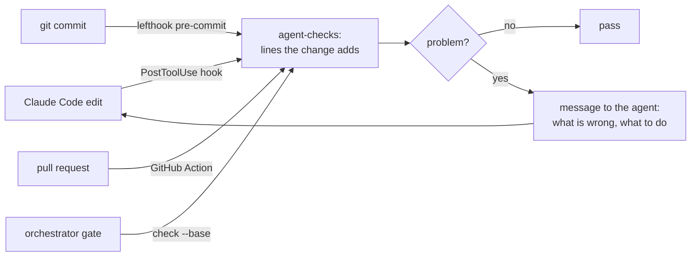

<!-- readme:header:start -->
<p>
  
  <a href="https://github.com/Egoushka/agent-checks/actions/workflows/ci.yml"></a>
  
</p>
<!-- readme:header:end -->

# agent-checks

> Fast commit and CI checks that catch what coding agents get wrong and tell the agent how to fix it.

<!-- readme:status:start -->
**Active**. I work on it this month.
<!-- readme:status:end -->



## Why

Coding agents fail in a few repeatable ways: they skip the failing test, catch and drop the exception,
silence the warning, leave a `NotImplementedException`, or write a test that asserts nothing and call the
task verified. Rules in a prompt file are a hope. Geoffrey Huntley's idea, a hook that reads the diff and
fails with a message addressed to the agent, turns each rule into a mechanism: the agent reads the
message and fixes the cause in the same loop. I wanted that for every repo I own, fast enough to run on
every edit, and strict only about lines the change adds, so old code never blocks new work.

## What it does

- Checks only the lines a change adds: staged changes, a branch against its base, one commit, or one file
  right after an agent edits it.
- 28 rules in C#, Kotlin, Java, Python, TypeScript/JavaScript, Go and shell: skipped, focused or
  tautological tests, tests without an assertion, fixed sleeps in tests, deleted tests and assertions,
  empty catches, `throw ex;`, `async void`, silenced warnings, weakened quality gates, stubs, TODOs
  without an issue, commented-out code, debugger leftovers, conflict markers, private keys, `.env` files.
- Runs typos, ruff and shellcheck and keeps only what they report on added lines, so a repo can adopt them
  without fixing its history first.
- Every failure message is an instruction: what is wrong and what to do instead. A deliberate exception
  takes a marker with a reason, `agent-checks: allow <rule> -- <why>`, and the check reports it.
- One install per repo: `agent-checks install` writes `lefthook.yml` and `.agent-checks.toml`, and moves
  existing `.githooks` scripts under lefthook.

Not here: formatting (each stack's formatter does it better), full linting of old code, and anything that
needs a build. `dotnet format` runs on pre-push because it takes seconds, not milliseconds.

## Quick start

```bash
uv tool install git+https://github.com/Egoushka/agent-checks@v0.1.4
brew install lefthook betterleaks zizmor  # the commit-hook runner, the secret scanner, the workflow linter
cd your-repo && agent-checks install  # writes lefthook.yml + .agent-checks.toml, installs the hooks
agent-checks check                    # what you have staged, or the working tree against HEAD
```

In CI, on pull requests (check out at least two commits so the base is present):

```yaml
- uses: actions/checkout@v7
  with: { fetch-depth: 2 }
- uses: Egoushka/agent-checks@v0.1.4
```

For Claude Code, one `PostToolUse` hook on `Edit|Write|MultiEdit` that runs `agent-checks hook claude`.
It does nothing in repos without `.agent-checks.toml`; where there is one, a problem in the lines just
written comes back to the agent before it moves on.

## How it works

`git diff -U0` gives the added lines per file. Content for the structural pass comes from where the
change lives: the index for a commit, the commit itself for `--commit`, the working tree otherwise, read
in one `git cat-file --batch` call, so partial staging never shifts a line number. Three passes run in
parallel: regex rules on the added lines, one `ast-grep` scan with the structural rules in
[`src/agent_checks/data/rules`](src/agent_checks/data/rules), and the linters. A finding counts only if
it touches an added line. Deleted tests and assertions are counted across the whole change, so a test
moved between files is not a deletion.

## Numbers

Measured on an M-series MacBook with the machine under load (load average 25), `agent-checks check
--commit` as a fresh process over each repo's last 20 commits, interpreter start included
(`agent-checks bench` reproduces the in-process part):

| Repo | Median added lines | p50 | p95 |
|---|---|---|---|
| chargehand (C#, TS) | 77 | 193 ms | 349 ms |
| feed-eater (C#) | 494 | 218 ms | 482 ms |
| nytka android (Kotlin) | 58 | 179 ms | 369 ms |
| personal-website (TS) | 27 | 163 ms | 233 ms |
| homelab-gitops (YAML, shell, Python) | 5 | 165 ms | 233 ms |

The Claude Code hook on a 405-line C# file with 10 added lines: 169 ms p50, 389 ms p95.

Calibration: over the last 40 commits of 11 of my repos (about 360 commits, written by me and by agents),
the error rules fired 22 times: 13 fixed delays in tests, 6 suppressions without a reason, 1
`continue-on-error`, and one commit that deleted 7 tests. Before the calibration pass the same history gave
220 findings; the drop came from moving typos and whitespace to warnings, reading assertion helpers
(`shows(...)`, `EnsureParsed(...)`) as assertions, and counting moved tests as moves.

## Docs

- [docs/rules.md](docs/rules.md): every rule, its scope and whether a marker can allow it, plus the
  config file.
- [docs/beyond.md](docs/beyond.md): what else raises agent code quality (diff coverage, mutation testing
  on changed code, snapshots, property tests), ranked with a recommendation.

<!-- readme:footer:start -->
---

<sub>Made by [Yehor Hrabovskyi](https://hrabovskyi.online) · [MIT licence](LICENSE).</sub>
<!-- readme:footer:end -->
